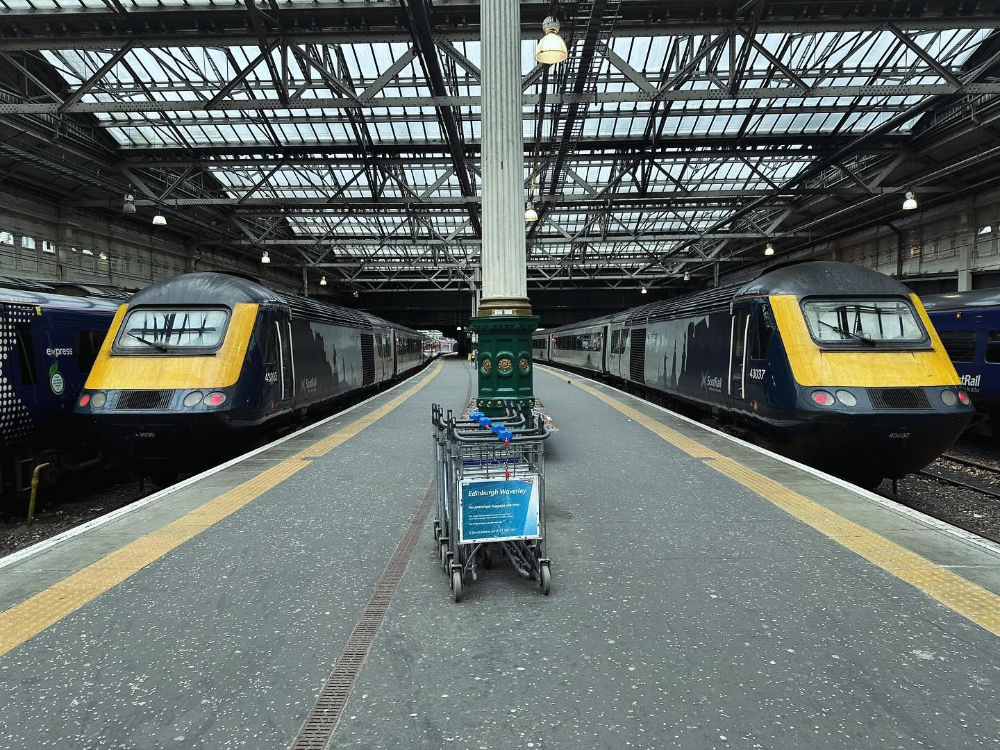
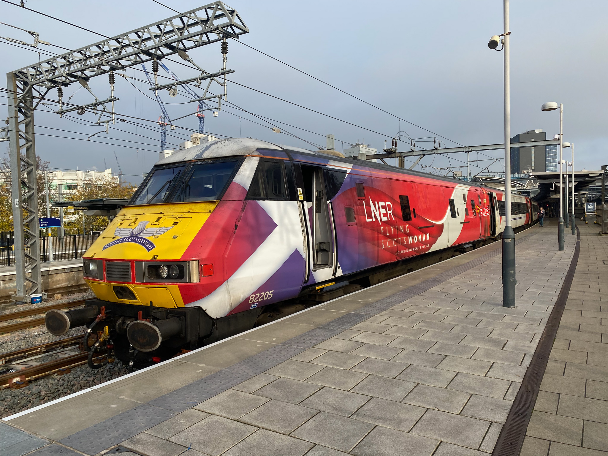
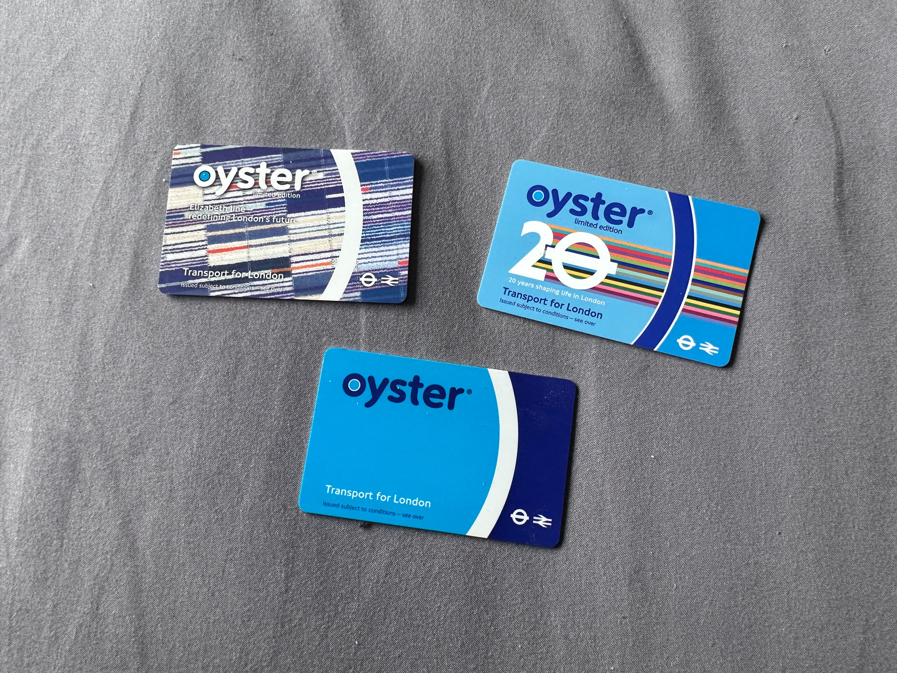
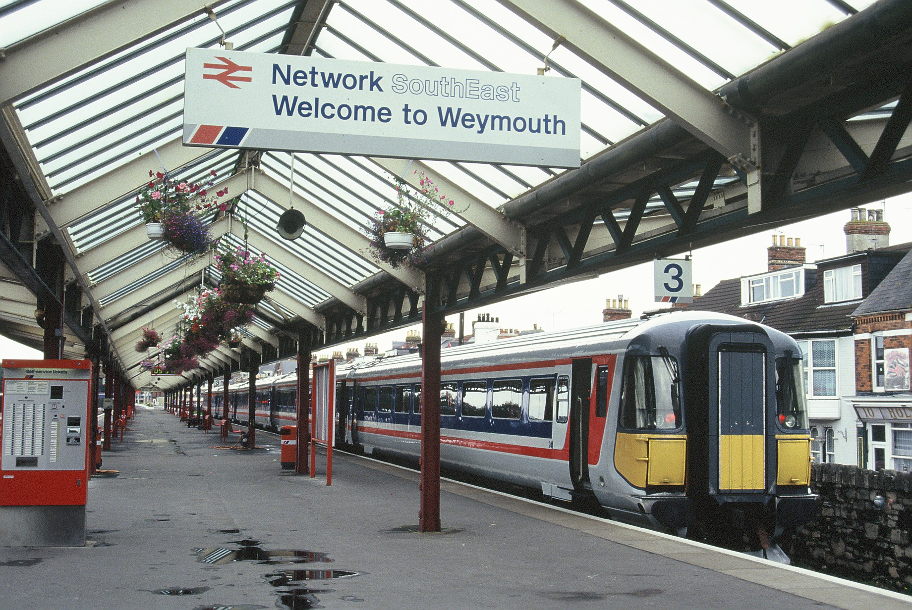

+++
title = 'Rail Nationalisation: What I want to see'
draft = false
date = 2024-07-24T11:45:00+01:00
categories = [
    "Politics",
    "Transport"
]
tags = [
    "trains",
    "politics",
    "travel",
    "transport",
]
+++

It looks like the railways in the UK are going to be finally taken back into public ownership. In this parliamentary term the current Labour government will bring forward two bills, first to allow the the railways to be run directly by a public body and the second to set up a public body called Great British Railways to oversee the running of the railway. 

## Privatisation, a "quick" history. 

Apologies if I get a bit to in the weeds with this *zips up anorak* 

Private running of our railways wasn't exactly a new concept, going back to its earliest days the railways were entirely privately run with basically zero oversight by the government, only needing an act of parliament to allow the construction of the tracks. Throughout the mid to late 1800s several laws were put on the books to try and establish basic rules for railways such as a common track gauge and semi standardised ticket types, but the system was still fragmented, messy and confusing for the passenger. Grouping after the First World War did some work to making the system work in the common interest, but it wasn't until 1947 where the government took over the bombed ruins of the railways and created British Rail.

This public body wasn't without issues, the Beeching cuts led to many smaller lines being closed despite being vital to the communities they served, and the system was chronically underfunded, especially during its later years under the Thatcher government. Under John Major's government, emboldened by the EU directive making it a requirement to allow for private operators to run on railway infrastructure, the Railways Act 1993 was passed, breaking up British rail into hundreds of companies. The most important ones being:

* **Train Operating Companies / TOC** :  Companies that has tendered and won a franchised section of the railway.
* **Rolling Stock Companies / ROSCO** : Companies that owns the rolling stock and leases them out to TOCs.
* **Railtrack** : The company entrusted with the maintaining the track and other infrastructure.

The first casualty of the privatised railway was Connex, who held the franchise of the South Central region (services from Brighton, Littlehampton, Bognor Regis and Portsmouth to London), when the Strategic Railway Authority stripped them of the franchise after just 5 years due to poor financial management. 

Shortly after this, Railtrack, which had been under immense scrutiny after several high profile rail disasters, collapsed. It turned out that trying to extract profit from the routine maintenance of Infrastructure lead to corners being cut and a decrease in service quality, who would have thought? The job of Railtrack was given to a non profit body called Network Rail.

There are many other cases of Franchises being stripped or collapsing, I would recommend the Failed Franchises series by Vanmanyo on Youtube [link](https://www.youtube.com/@Vanmanyo/videos) for a more detailed look at the problems of the franchise system. 

### Operators of Last Resort 

One of the clearest signs of the failures of the system implemented by the 1993 act are the Operators of Last Resort. These are private companies set up by the government to take over the running of a franchise when they collapse or OLRs . The first usage of these was when the Strategic Rail Authority stripped Connex South Eastern for, you guessed it, poor financial management. This publicly owned operator ran the franchise for just over 3 years before being put back out to tender and run again by the private sector. Funnily enough this same franchise is currently also run by a OLR as the previous franchise had account discrepancies in the 10s of millions of pounds. 

In the 30 years of the private sectors operation of the trains we have seen 7 of these ORLs (not including the Welsh and Scottish operators that have used this legislation to run quasi nationalised systems). One interesting case of this is the East Coast Franchise, where every private franchise has imploded spectacularly, whilst the 2 public operators ran relatively smoothly and have generated consistant profit. 

### The Pandemic and the end of franchising

I'm not sure if any one else noticed but the world came to a halt in 2020 because of the COVID-19 pandemic and it turns out that almost no one being allowed outside is bad for a for profit transport system that requires ticket sales to not fall on its arse. To keep the services running for key workers and to make sure there was still a rail industry when it was considered safe to go outside again, the Department For Transport stepped in and suspended franchising, and covered losses for the operators. While this succeeded in keeping the trains moving, it was far from a long term solution.  Under the previous Conservative government a commission was set up to investigate what a post COVID rail system would look like, the result of which was called Great British Railways, which would operate a system of concession contracts for larger regions of the UK. This initial version of GBR languished in parliamentary hell while the tories were busy trying to out bigot each other. 

## Nationalisation 

So that brings us to today, we have a new Labour (ish) government proposing the gradual nationalisation of the Railways as previous contracts expire with those TOCs. I've put together what amounts to an ideal wishlist for a modern nationalized railway in the UK. 

### General operation 
* **Flat ticket pricing**: Ticket Pricing is incredibly confusing at the moment, there are 5 different types of tickets you can get for a single or return journey, all with different pricing and restrictions. Its a system that has even confused ticket inspectors on occasion (and lead to me nearly being kicked off of a train despite having a valid ticket). The actual pricing of tickets is up to the TOC and is often set without rhyme or reason. A nationalized operator would need to set out clear and transparent rules on ticket pricing and passengers would definitely benefit from a simplified ticketing system, even down to one type of ticket for a single journey and a season ticket for commuters. 

* **Nationwide rollout of a Smart Card system**: London has had great success with its Oyster Scheme and the entire nation of The Netherlands has been able to implement its OV-chipkaart system as an integrated payment method for payment on its services. Travel in the UK would be made so much more convenient if all that was needed to get on a train was tapping a card. 

*  **Better integration with buses**: Buses are a necessity for an integrated transport system, especially in rural areas. Train Stations need to have options for buses to stop at them and bus timetables should be set in such a way that allows them to easily get on a train.  

* **Increase late night and weekend operations**: As someone who frequently goes to gigs, I have lost track of the amount of times where I have had to leave early to make the last train. Running trains where possible into the early morning (like 1-2am) in more areas would help revitalize nightlife in towns and cities and allow more people to get home safely from late night activities. 

### Branding

* **Consistant Liveries**: All GBR passenger trains need to clearly show that they are in fact the public operator, whilst also denoting the purpose of the train, if I had unilateral control of branding I would split it like this,
    * *Intercity*: Your long haul fast services. Essentially the Intercity branding of BR old 
    * *Regional Rail*: Slower services that go between Towns and cities, I.E Services from Crewe to Manchester or Southampton to Weymouth.
    * *Commuter Rail*: with some way to easily denote what area its serving, each major city needs a form of commuter rail to orbital towns. If there has been one benefit of each franchise having its own distinct livery, its that it is always pretty clear what trains go where, especially in busy London termini. 

  This system is based heavily on the sectorised branding of BR from the 1980s with a few differences for clarity and ideally less of a focus on just London. 

* **Bring back the Double Arrows**: This might just be nostalgia, but its a good logo and really should continue to be used. 

* **Consistent typography, iconography and formatting**: Everything from advertising to signage within stations need to be based on a standardized format, a single font and icon system, to make it clear what is from GBR and what isn't. TFL does a very good job on this and in my opinion is a model to follow. 

### Infrastructure

* **Reopen Beeching Closures**: In the 60 years since the Reshaping Britain's Railways report, its become clear that a lot of the routes axed would have become vital routes for commuters if still available, where possible these routes should be reopened and extended. 

* **Electrify all passenger routes**: At the time of writing only around 40% of track in the UK is electrified, this means that a large percentage of services are run with diesel units, even when a large percentage of the route is actually able to be run electrically. This can be mitigated somewhat with BiModal or even TriModal units, but that is a band aid solution and often a worst of all worlds scenario. With the threat of global climate disaster we need to be reducing our dependance on Oil at every opportunity.  

* **Actually build HS2, connect it to HS1 and improve rail services with Europe**: Following on from the previous point, if we want to reduce the use of cars, we ned to make rail journeys faster and more convenient. A high speed rail corridor between the north and London is vital to meet that goal. In addition, not connecting HS2 to HS1 makes both of them far less appealing, especially for those in the north. Finally, if we want to reduce our dependence on planes, we need to increase our train services that travel to Europe. When the Channel Tunnel was being built, a lot of hay was made about services from "Manchester to Paris" and "Newcastle to Nice" . but this never happened, Services were stuck in London. If we want to tackle budget airlines, we need to be able to offer comparable routes. 

* **Do Away with ROSCOs**: In the old franchise model, it did make some sense to have a separate company to handle owning the trains, but in a nationalised model it absolutely doesn't, not unless there is some long term goal to abandon public ownership. I know this seems self evident, but there has been very little talk about the fate of ROSCOs under the current plans and it worries me. 

* **Level boarding at platforms**: The fact the UK has barely made any steps towards level boarding is madness. We need to define a standard platform and carriage heights for new rolling stock. the state of platforms currently leads to [injuries](https://www.bbc.co.uk/news/articles/cqe6zm53neyo) and prevents people with reduced mobility from using our rail network. 

* **Freight and non passenger services**: Once again, I find it mind boggling that freight isn't better used in this country. Why in the age of online every station in a town or city doesn't have a goods yard anymore is beyond me, shopping hundreds of trucks could be kept of the road  by having all but the last minute haulage be handled by freight rail. Every opportunity to reduce the number of road vehicles should be at least considered.

### Miscellaneous 

* **Ensure old rolling stock is properly preserved** Privatisation lead to a very large scale replacement of rolling stock, especially in the southern region, and in my opinion not enough was done to preserve units for their historic value. the class 442 is a very good example of this, where one cab and one driver carriage has been saved, with every other unit scrapped. Some form of GBR railway museum would be fantastic for perseveration. 

* **Incentivise major cities to build and expand their own rapid transport network** As cities in the UK get bigger, its becoming abundantly clear that a network of just buses is not enough. Manchester, Birmingham, Glasgow Liverpool and Newcastle all have varying levels of rapid transport (no, Im not counting the singular Edinburgh tram route as a rapid transport network, network implies there is more than one route.), but all of them need expansion to reduce car dependency. a rapid transport system that integrates well with heavy rail, such as what exists currently in London should be seen as an aspirational goal for all cities here in the UK. 

## Conclusion

So thats my wishlist, its a bit idealistic in places, and would require more legislative changes than an override of the 1993 Railways act, but I genuinely think that the rail network in the UK is hugely underutilised and could be genuine force for social progress if change were implemented. Overall I think the most important thing for whatever body comes in to replace the franchises is they need to stop thinking of transport as a profit generating exercise. If there is one consistant thread throughout the history of public transport in this country, it is that vital changes have been put off or ignored until too late in the name of saving money and short term profit is viewed with more importance than long term sustainability. 

I don't think the new Labour Government will institute many of the changes I've outlined here, if for no other reason than they seem to be wedded to the same neoliberal monetary policies that were used to justify selling BR and many other services off in the first place, but I hope that at some point in the future we can have a public transport system that works for all of us. 

(A huge thank you to Wikimedia projects and the photographers credited for the additional photos on this post. As much of a train nerd as I am, I lack a time machine that would allow me to go and get photos of old trains in old liveries.)